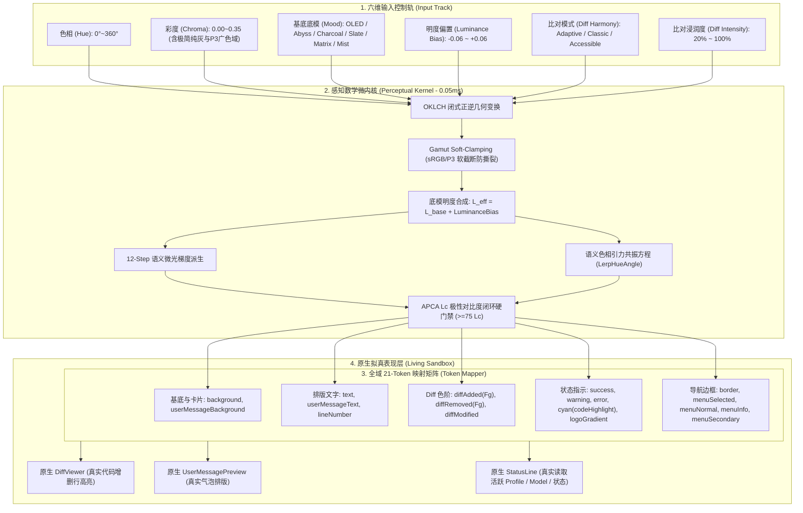

# Perceptual Color Science & Adaptive Theme Conventions — 感知色彩科学与自适应主题设计规范

> 定位：定义 Snow CLI 交互式终端应用中，基于 **OKLCH 感知色彩空间、APCA 空间极性对比度数学、语义色相引力共振与无障碍双轨架构** 的现代终端色彩工程规范与质量验收标准。
> 参照先例：`color-science-engine` 范式、`W3C APCA (Advanced Perceptual Contrast Algorithm)`、`Display-P3 vs sRGB Gamut Mapping`、`Catppuccin Delta` 语义色彩拓扑。
> 核心哲学：**拒绝固定常数孤岛，拥抱全域动态共振；拒绝拼凑伪装沙盒，回归真实组件一致性；命名中规中矩，杜绝浮夸包装**。

---

## 1. 架构总览与全域拓扑关系图（System Architecture & Topology）

自适应主题系统由四层流水线严格单向流动推导：

---

## 2. 核心数学模型与推演公式

### 2.1 Chroma（彩度）物理色域分段与防撕裂保护

OKLCH 中的彩度 $C$ 是绝对数值，必须按硬件显色极限进行科学分段管理：

| 彩度区间 | 语义定位 | 物理发光与色域特性 | 界面应用场景 |
| :--- | :--- | :--- | :--- |
| **`0.00 ~ 0.04`** | 极简单色阶 (Achromatic Monospaced) | 完全剔除色相杂质或保留微量冷暖 | 水墨极简风格、纯灰代码审阅、深夜零视觉刺激 |
| **`0.05 ~ 0.20`** | sRGB 黄金安全区 (Standard Web Safe) | 100% 处于 sRGB 物理色域内，绝不发生显示器截断 | 标准生产力终端、绝大多数外接显示器基准 |
| **`0.21 ~ 0.35`** | Display P3 广色域高光区 (Vibrant P3) | 释放 OLED / Mini-LED / MacBook 的高纯度表现力 | 核心 Accent、焦点按钮、警告徽标；启动 Gamut Soft-Clamping 保护 |

**Gamut Soft-Clamping 方程**：
当 $C > 0.22$ 且转换至 RGB 出现溢出时，保持感知明度 $L$ 与色相 $H$ 不动，仅沿彩度轴进行径向非线性压缩，杜绝色相翻转与脏色生成：

$$
C_{\text{safe}} = \min(C, C_{\text{max}}(L, H))
$$

### 2.2 基底底模（Mood Archetypes）与明度偏置合成

彻底摒弃“纯固定不可调”或“纯无级混乱拉动”的两种极端，采用**基锚 + 偏置**双轨模型：

$$
L_{\text{effective}} = \text{clamp}(L_{\text{base}} + \Delta L_{\text{bias}}, 0.03, 0.26)
$$

六大基锚标定如下：

| 基底标识 | 中文释义 | 基准明度 $L_{\text{base}}$ | 基底微色彩度 $C_{\text{base}}$ | 硬件与使用场景 |
| :--- | :--- | :--- | :--- | :--- |
| `oled` | 极致深黑 | 0.04 | 0.00 | OLED 像素完全关闭，无限对比度 |
| `abyss` | 深渊幽黑 | 0.08 | 0.01 | 消除 OLED 拖影（Black Smearing）的最低安全灰度 |
| `charcoal` | 暖炭色调 | 0.11 | 0.02 | 吸收高能蓝光，深夜长时间专注 |
| `slate` | 北欧冷灰 | 0.14 | 0.02 | 标准办公与长时间代码审阅黄金基准 |
| `matrix` | 复古黑客 | 0.09 | 0.03 | 纯黑与经典磷光微光 |
| `mist` | 浅雾低反差 | 0.20 | 0.01 | 高环境光、室外或防屏幕反光场景 |

### 2.3 Diff 色阶三大共振模式与浸润度标定

Diff 增删改背景色拒绝写死固定常数，支持三种算法模式：

1. **`adaptive`（自适应色相引力共振）**：
   - 新增色（Added）：$\theta_{\text{base}} = 142^\circ$（语义翠绿），向全局主色相 $\theta_{\text{ambient}}$ 牵引 25%；
   - 删除色（Removed）：$\theta_{\text{base}} = 25^\circ$（语义赤红），向全局补色 $(\theta_{\text{ambient}} + 180^\circ) \pmod{360}$ 牵引 25%；
   - 当全局彩度 $C \rightarrow 0$ 时，Diff 底色彩度同步等比收敛，防止单色下冒出荧光色块。
2. **`classic`（传统经典模式）**：
   - 保持标准的 Git-Diff 纯绿（142°）与纯红（25°）。
3. **`accessible`（无障碍色盲友好模式）**：
   - 针对红绿色盲（Deuteranopia/Protanopia），改用**高辨识度天蓝（210°）作为新增**，**琥珀橙/洋红（45°/350°）作为删除**。

**Diff 浸润度（Diff Intensity）公式**：
$$
L_{\text{diffBg}} = L_{\text{effective}} + \Delta L_{\text{step}} \times (\text{diffIntensity} / 100)
$$
$$
C_{\text{diffBg}} = \text{clamp}(C_{\text{global}} \times 0.4 \times (\text{diffIntensity} / 100), 0.02, 0.12)
$$

### 2.4 APCA 极性对比度硬门禁

$$
|\text{APCA}(\text{Foreground}, \text{Background})| \ge 75\ \text{Lc}
$$

若初次派生计算未达 75 Lc，微内核自动进入循环，步进提升前景色明度 $L_{fg}$，直到达成硬门禁标准，确保终端字符可读性。

---

## 3. 规范命名与参数矩阵

系统对用户暴露的所有配置项一律采用业界通用的中规中矩命名，严禁浮夸装饰词：

| 中文界面名称 | 英文字段标识 | 数据类型 | 可调范围与步长 | 默认推荐值 |
| :--- | :--- | :--- | :--- | :--- |
| **色相** | `hue` | 整数 (deg) | `0 ~ 360` (步长 5 / Shift 15) | `215` |
| **彩度** | `chroma` | 浮点数 | `0.00 ~ 0.35` (步长 0.01 / Shift 0.05) | `0.16` |
| **基底底模** | `mood` | 枚举 | `oled` / `abyss` / `charcoal` / `slate` / `matrix` / `mist` | `slate` |
| **明度偏置** | `luminanceBias` | 浮点数 | `-0.06 ~ +0.06` (步长 0.01) | `0.00` |
| **比对配色** | `diffHarmony` | 枚举 | `adaptive` / `classic` / `accessible` | `adaptive` |
| **比对浸润度** | `diffIntensity` | 整数 (%) | `20% ~ 100%` (步长 5%) | `75%` |

---

## 4. 原生拟真表现层（Living Sandbox）一致性规程

1. **严禁硬编码伪字符**：禁止在沙盒中使用 `┏━━━` 等手绘伪边框拼凑伪界面。
2. **复用原生业务组件**：
   - 代码比对必须实例化原生的 `DiffViewer`；
   - 用户输入气泡必须实例化原生的 `UserMessagePreview`；
   - 上下文状态必须通过 `getActiveProfileName()` 与 `loadProfile()` 动态读取真实的活跃 Profile 与 Model 配置，杜绝任何假造的“Claude-3.7-Sonnet (98%)”。
3. **内存热联动与零磁盘抖动**：
   - 预览沙盒通过局域 `ThemeContext.Provider` 注入内存派生调色板，按 60FPS 实时共振；
   - 严禁在滑块拖动过程中高频写入磁盘文件，唯有用户按下 `S` 或 `Enter` 时方持久化至 `~/.snow/theme.json`。
