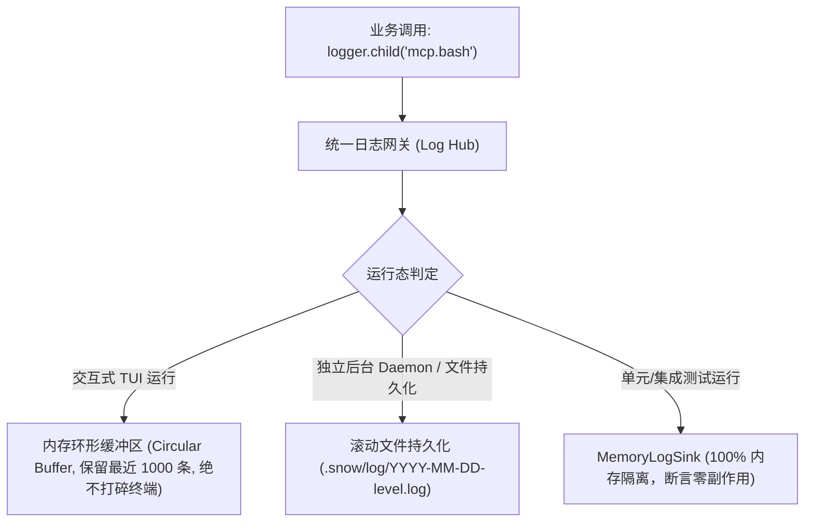

# 02. 结构化日志与可观测性规范 (Logging & Observability Conventions)

> **位置**：`conventions/02-logging-and-observability.md`  
> **状态**：Active / Baseline

---

## 一、核心痛点与终端防御 (TUI Safe-Guards)

1. **终端 ANSI 击穿防御**：
   - Snow CLI 是基于 Ink / React 构建的交互式虚拟终端应用；
   - 严禁在业务底层直接调用 `console.log` / `console.error`。未经受控的直接输出会破坏 Ink 虚拟终端缓冲区的光标定位，导致界面字符重影、抽搐和乱码。
2. **上下文追踪缺失**：
   - 并发 Subagent 与 MCP 工具调度时，纯文本日志无法区分事件来源；
   - 必须通过结构化日志数据模型绑定 `sessionId`、`taskId`、`traceId` 与 `namespace`。

---

## 二、结构化日志模型 (ECS / OpenTelemetry Compatible)

统一日志模型兼容 Elastic Common Schema (ECS) 与 OTel 语义：

```ts
export interface StructuredLogEntry {
    // 基础时空维度
    timestamp: string;          // ISO 8601 (精确到毫秒)
    level: 'ERROR' | 'WARN' | 'INFO' | 'DEBUG';
    
    // 来源与上下文维度
    namespace: string;          // 模块域命名空间，如 'execution.toolExecutor'
    sessionId?: string;         // 关联会话 ID
    taskId?: string;            // 关联后台任务 ID
    traceId?: string;           // 单次调用追踪链路 ID
    spanId?: string;            // OTel Span 标识
    parentSpanId?: string;      // 父 Span 标识
    
    // 性能与时序维度 (APM & Performance Integration)
    durationMs?: number;        // 毫秒级耗时指标 (如慢工具、LLM 首包/全量延迟)
    
    // 消息与载荷
    message: string;            // 规范的人类可读描述
    meta?: Record<string, unknown>; // 结构化上下文数据
    
    // 异常堆栈追踪
    error?: {
        name: string;
        message: string;
        stack?: string;
        code?: string | number;
    };
}
```

---

## 三、三层 Sink 隔离分流 (Three-Tier Sinks)



---

## 四、日志门禁与基于图的覆盖审计 (Logging Gates)

1. **静态调用门禁 (`LoggingDisciplineGuard`)**：
   - AST 扫描业务代码，对非 CLI 顶级交互入口的未授权 `console.log` / `console.error` 进行阻断并报错。
2. **基于依赖图拓扑的高入度节点审计 (Graph-based Coverage)**：
   - 依赖图入度（In-degree）高的核心枢纽模块（如 `sessionManager`, `toolExecutor`, `api/chat`）必须 100% 接入 Logger；
   - 重点检查 `catch` 异常分支，严禁“静默吞错”导致调试黑洞。
