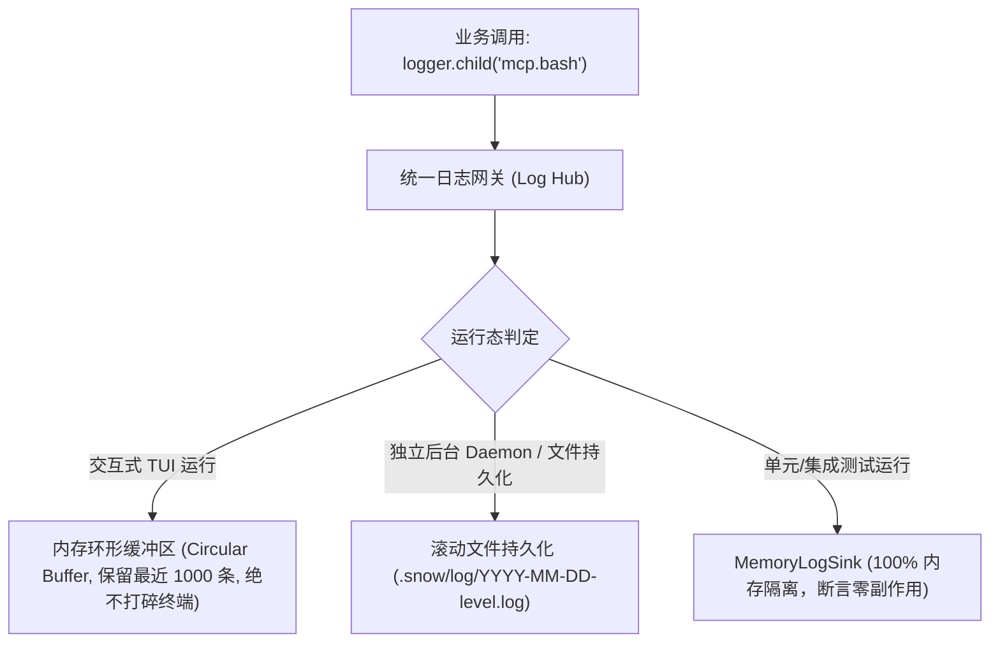

# 02. 结构化日志与可观测性规范 (Logging & Observability Conventions)

> **位置**：`conventions/02-logging-and-observability.md`  
> **状态**：Active / Baseline

---

## 一、核心痛点与终端防御 (TUI Safe-Guards)

1. **终端 ANSI 击穿防御**：
   - Snow CLI 是基于 Ink / React 构建的交互式虚拟终端应用；
   - 严禁在业务底层直接调用 `console.log` / `console.error`。未经受控的直接输出会破坏 Ink 虚拟终端缓冲区的光标定位，导致界面字符重影、抽搐和乱码。
2. **上下文追踪缺失**：
   - 并发 Subagent 与 MCP 工具调度时，纯文本日志无法区分事件来源；
   - 必须通过结构化日志数据模型绑定 `sessionId`、`taskId`、`traceId` 与 `namespace`。

---

## 二、结构化日志模型 (ECS / OpenTelemetry Compatible)

统一日志模型兼容 Elastic Common Schema (ECS) 与 OTel 语义：

```ts
export interface StructuredLogEntry {
    // 基础时空维度
    timestamp: string;          // ISO 8601 (精确到毫秒)
    level: 'ERROR' | 'WARN' | 'INFO' | 'DEBUG';
    
    // 来源与上下文维度
    namespace: string;          // 模块域命名空间，如 'execution.toolExecutor'
    sessionId?: string;         // 关联会话 ID
    taskId?: string;            // 关联后台任务 ID
    traceId?: string;           // 单次调用追踪链路 ID
    spanId?: string;            // OTel Span 标识
    parentSpanId?: string;      // 父 Span 标识
    
    // 性能与时序维度 (APM & Performance Integration)
    durationMs?: number;        // 毫秒级耗时指标 (如慢工具、LLM 首包/全量延迟)
    
    // 消息与载荷
    message: string;            // 规范的人类可读描述
    meta?: Record<string, unknown>; // 结构化上下文数据
    
    // 异常堆栈追踪
    error?: {
        name: string;
        message: string;
        stack?: string;
        code?: string | number;
    };
}
```

---

## 三、三层 Sink 隔离分流 (Three-Tier Sinks)



---

## 四、日志门禁与基于图的覆盖审计 (Logging Gates)

1. **静态调用门禁 (`zeroConsoleLeakGuard`)**：
   - AST 扫描业务代码，对非 CLI 顶级交互入口的未授权 `console.log` / `console.error` 进行阻断并报错，保持业务域 100% 绝对零泄漏。
2. **盲目吞错门禁 (`zeroSilentCatchGuard`)**：
   - 检测所有无日志或未抛出的盲目空 `catch {}` 块，执行“可观测安全降级（Graceful Degradation with Observability）”，通过单向棘轮门控持续下锁。
3. **沙箱存储泄漏门禁 (`zeroLeakStorageGuard`)**：
   - 严禁任何业务模块绕过 `snowContext` 直接硬编码 `homedir()/.snow`，违规数严格清零。

---

## 五、命名空间派生与分级合规规范 (Namespace & Hierarchy Discipline)

1. **杜绝根命名空间直调（Root Namespace Contamination Defense）**：
   - 严禁在除应用顶级启动入口（如 `cli.tsx`）之外的业务模块中直接调用全局单例 `logger.info()` / `logger.debug()`；
   - 所有业务模块必须显式声明并派生专属命名空间的子 Logger：
     ```ts
     // ✅ 标准合规写法：具备清晰二级/三级层级
     import {logger} from '../core/logger.js';
     const log = logger.child('mcp:aceCodeSearch');
     const log = logger.child('execution.teamExecutor');
     ```
2. **命名空间格式统一**：
   - 顶层域建议使用冒号或点分隔：`mcp:<toolName>`、`execution.<module>`、`session.<submodule>`、`ui:<component>`；
   - 保证日志过滤时可精准执行 `grep "mcp:"` 或按 TraceId/SpanId 过滤。
3. **环形缓冲区与归一化配置 (Unified Logging Settings)**：
   - 内存环形缓冲区默认上限为 1000 条，可通过环境变量 `SNOW_LOG_BUFFER_SIZE` 或 `settings.json` 中 `logging.bufferSize` 进行归一化动态配置；
   - 归一化读取接口收拢于 `getLoggingConfig()`。
